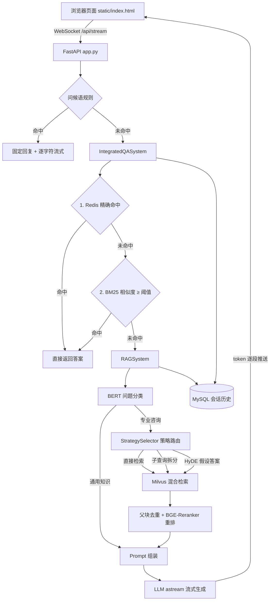

# RAG_Demo

一个基于 **FastAPI + LangChain + Milvus + BGE** 的检索增强生成（RAG）智能问答系统 Demo。

系统采用 **「FAQ 精确匹配 + RAG 检索生成」双通道架构**：先走 BM25 快速命中企业 FAQ，命中不了再进入 RAG 链路（问题分类 → 检索策略路由 → 混合检索 → 重排序 → 大模型生成），并通过 WebSocket 把答案**流式**推送到前端页面。

> ⚠️ **本项目是教学 / 演示性质的 Demo，不能直接用于生产环境。**
> 实际使用前 **必须修改 `config.ini`** 中的 MySQL、Redis、Milvus、LLM 等配置（详见下方 [配置说明](#重要提示实际使用前必须修改-configini)）。

> 🧠 **重要：仓库内不使用本地模型权重，且本地 `model/` 里的副本可能已经落后。**
> `model/` 目录约 **6.7 GB**，因为 GitHub 单文件 100 MB 的限制无法入库（详见 [模型说明](#模型说明模型版本可能落后请自行下载最新版)）。
> 仓库里的 `bge-m3`、`bge-reranker-large`、`bert_query_classifier` **很可能不是最新版本**，建议直接到官网 / 模型页下载当前最新版，而不要沿用旧副本。

---

## 目录

- [核心特性](#核心特性)
- [是否支持流式输出](#是否支持流式输出)
- [技术栈](#技术栈)
- [系统架构](#系统架构)
- [大致实现过程](#大致实现过程)
- [项目结构](#项目结构)
- [快速开始](#快速开始)
- [模型说明：模型版本可能落后，请自行下载最新版](#模型说明模型版本可能落后请自行下载最新版)
- [⚠️ 重要提示：实际使用前必须修改 config.ini](#重要提示实际使用前必须修改-configini)
- [接口一览](#接口一览)
- [常见问题](#常见问题)

---

## 核心特性

| 功能 | 说明 |
| --- | --- |
| FAQ 双通道问答 | 先查 Redis 精确缓存 → 再走 BM25 相似度匹配 → 都不命中才调用大模型，显著降低响应时延与 Token 成本 |
| 问题分类路由 | 微调 BERT 对问题做二分类（`通用知识` / `专业咨询`），通用问题直接回答，专业问题才进知识库检索 |
| 动态检索策略 | 由 LLM 在「直接检索 / 子查询检索 / HyDE 假设答案检索」三种策略中自动择优 |
| 混合检索 | BGE-M3 同时产出稠密 + 稀疏向量，Milvus 双路召回后用 `WeightedRanker` 加权融合 |
| 重排序 | BGE-Reranker-Large 交叉编码器对父块重新打分，取 Top-N 作为上下文 |
| 父子分块 | 子块（300 字）负责精准召回，父块（1200 字）负责提供完整上下文，避免语义被切碎 |
| 多格式解析 | PDF / Word / PPT / 图片 / Markdown / TXT，扫描件与图片走 OCR |
| 会话记忆 | MySQL 按 `session_id` 保存对话历史，保留最近 5 轮注入 Prompt，支持历史会话回看 |
| 前端页面 | 原生 HTML/CSS/JS，玻璃拟态 + 机器人科技背景（内联 SVG），支持多会话管理、历史搜索、技术方向过滤、Markdown 渲染、深/浅色主题 |

## 是否支持流式输出

**支持，且是端到端流式。**

- **传输层**：`/api/stream` 是 WebSocket 长连接，服务端按事件类型逐条推送 `start` → `token` → `end`（或 `error`）。
- **模型层**：大模型调用使用 LangChain 的 `llm.astream(prompt)` 异步流式接口，`chunk.content` 一到就转发给前端。
- **FAQ 通道**：命中 FAQ 时没有大模型可流式，代码用逐字符 `yield`（间隔 10ms）模拟打字机效果，保证前端体验一致。
- **前端渲染**：WebSocket 收到 token 后累积字符串，用 `requestAnimationFrame` 节流刷新 DOM（并做 Markdown 渲染），避免每个 token 都触发重排。

> 说明：RAG 链路中的**检索、重排是同步阻塞**的（先检索出上下文，才开始调模型），所以首 token 延迟包含「检索 + 重排 + 模型首包」时间；只有**答案生成**是流式的。`/api/history`、`/api/sessions` 等 REST 接口为普通非流式响应。

## 技术栈

| 分层 | 技术 / 组件 |
| --- | --- |
| Web 框架 | FastAPI、Uvicorn、Starlette（WebSocket / StaticFiles / CORS） |
| 前端 | 原生 HTML + CSS + JavaScript、marked.js（Markdown 渲染）、Font Awesome |
| LLM 编排 | LangChain（`langchain` 1.x、`langchain-core`）、`init_chat_model`、`PromptTemplate` |
| 大模型 | DeepSeek（OpenAI 兼容接口，默认 `deepseek-flash`），可替换为其他兼容模型 |
| 文本向量 | BGE-M3（`milvus-model` 的 `BGEM3EmbeddingFunction`，中文/多语言，稠密 + 稀疏） |
| 向量数据库 | Milvus 2.5（`pymilvus`），`IVF_FLAT`（IP）稠密索引 + `SPARSE_INVERTED_INDEX` 稀疏索引，`hybrid_search` 混合检索 |
| 重排序模型 | BGE-Reranker-Large（`sentence-transformers` 的 `CrossEncoder`） |
| 问题分类模型 | 微调后的 BERT（`transformers` + PyTorch，`BertForSequenceClassification`） |
| FAQ 检索 | `rank_bm25`（BM25Okapi）+ `jieba` 分词 + softmax 归一化阈值判定 |
| 关系型数据库 | MySQL 8（`PyMySQL`）：FAQ 知识库表 + 会话历史表 |
| 缓存 | Redis（`redis-py`）：FAQ 问题列表、分词结果、答案缓存 |
| 文档解析 | PyMuPDF（PDF）、RapidOCR（`rapidocr-onnxruntime` / `rapidocr-paddle` 图片 OCR）、python-docx、python-pptx、OpenCV、unstructured |
| 日志 | 标准库 `logging`，文件 + 控制台双输出 |

主要版本参考 `requirements.txt`：`fastapi==0.115.12`、`pymilvus==2.5.4`、`langchain==1.2.10`、`torch==2.10.0`、`transformers==4.45.0`、`FlagEmbedding==1.3.5`。

## 系统架构



典型请求链路（一次提问）：

1. 前端把 `query`、`source_filter`、`session_id` 通过 WebSocket 发给后端。
2. 后端先做**问候语正则匹配**（你好 / 你是谁 / 在吗 …），命中就直接返回并写会话历史。
3. 否则进入 `IntegratedQASystem.search()`：
   - Redis 查 `answer:{question}` 精确缓存；
   - BM25 对 MySQL 中的 FAQ 问题做相似度检索，softmax 归一化后与阈值 `0.85` 比较；
   - 命中即返回 FAQ 答案，并回写 Redis 缓存。
4. FAQ 未命中 → `RAGSystem.generate_answer()`：
   - BERT 分类判断是「通用知识」还是「专业咨询」；
   - 专业问题由 `StrategySelector` 调 LLM 选检索策略（直接 / 子查询 / HyDE）；
   - 检索结果做**父块去重**、**CrossEncoder 重排**，截取 `candidate_m` 条作为上下文；
   - 读取 MySQL 最近 5 轮历史，与上下文一起套入 `rag_prompt`；
5. 调用大模型流式生成，token 实时推给前端，结束后把本轮问答写入 MySQL。

## 大致实现过程

### 1. 数据准备与文档解析

`rag_qa/core/document_processor.py` 提供统一的加载器映射表（txt / pdf / docx / ppt / pptx / jpg / png / md）：

- 递归遍历 `rag_qa/data/<方向>_data/` 目录，目录名去掉 `_data` 后缀即为**技术方向**（写入元数据 `source`，用于检索过滤）；
- PDF 用 PyMuPDF 抽文本，页面中大图（占比 ≥ 60%）截取后交给 OCR 识别，兼顾电子版与扫描版；
- Word / PPT 通过 python-docx / python-pptx 抽取文字与图片，图片同样走 OCR；
- 每个文档补充 `source`、`file_path`、`timestamp` 元数据，便于后续溯源。

### 2. 父子分块

- **父块**：按 `parent_chunk_size = 1200` 切分，保留完整语义段落；
- **子块**：在父块内部再按 `child_chunk_size = 300` 切分，`chunk_overlap = 50`；
- 子块通过 `parent_id` 关联父块，并把父块原文写入 `parent_content`；
- 中文用自定义 `ChineseRecursiveTextSplitter`（在分隔符上做中英文适配），Markdown 用 `AliTextSplitter` 保持结构。

> 检索用子块（粒度小、语义集中、召回准），生成用父块（上下文完整），这是本项目的核心设计之一。

### 3. 向量化入库（Milvus）

`rag_qa/core/vector_store.py` 负责向量库全生命周期：

- 用 BGE-M3 一次性生成**稠密向量**（语义）和**稀疏向量**（词项权重，替代 BM25 的稀疏侧）；
- 自动建库（`database_name`）、自动建集合（`collection_name`），Schema 含 `id`、`text`、`dense_vector`、`sparse_vector`、`parent_id`、`parent_content`、`source`、`timestamp`；
- 稠密索引 `IVF_FLAT` + `IP`（`nlist=128`），稀疏索引 `SPARSE_INVERTED_INDEX` + `IP`（`drop_ratio_build=0.2`）；
- 主键取文本 MD5，配合 `upsert` 实现幂等写入，重复导入不会产生脏数据。

### 4. 混合检索 + 重排序

`hybrid_search_with_reranker()` 是检索核心：

1. 查询文本经 BGE-M3 转为 dense / sparse 两路向量；
2. 构造两个 `AnnSearchRequest`（可附加 `source == 'xxx'` 过滤表达式），由 `WeightedRanker(0.7, 1.0)` 融合排名；
3. 召回子块后按 `parent_content` **去重还原成父块**；
4. 用 BGE-Reranker-Large 对 `(query, 父块)` 逐对打分并降序排序；
5. 截取 `candidate_m = 2` 条作为最终上下文。

### 5. 策略路由（进阶 RAG）

`rag_qa/core/strategy_selector.py` 用一段 Prompt 让 LLM 直接输出策略名：

- **直接检索**：意图明确、需要具体事实的问题（如「Spring Boot 如何实现自动配置」）；
- **子查询检索**：涉及多个实体/方面的复杂问题，先拆成最多 3 个子问题分别检索，再按文本去重合并；
- **HyDE 假设答案检索**：问题较抽象时，先让 LLM 生成一段假设答案，再用**假设答案**去检索，让语义空间更贴近文档；
- 任何一步异常都降级为「直接检索」或返回空列表，保证主链路不中断。

### 6. Prompt 与生成

`rag_qa/core/prompts.py` 维护所有模板，`rag_prompt` 会显式要求模型：

- 说明答案是否来自检索文档（如「根据提供的文档，……」）；
- 判断历史对话是否相关，相关才结合，不相关就忽略，避免上下文串味；
- 上下文与历史都不足时，统一回复「信息不足，无法回答，请联系人工客服，电话：{phone}」；
- 温度设为 `0.1`（生成）与 `0.3`（策略选择），前者求稳、后者求灵活。

### 7. Web 服务与会话

`app.py` 用 FastAPI 提供 REST + WebSocket：

- 实例化单例 `IntegratedQASystem` / `MySQLClient`，避免每次请求重复加载模型；
- `/api/stream` 用 `while True` 循环在同一连接上处理多轮提问，逐 token 推送，异常时下发 `error` 并关闭；
- `app.mount("/static", ...)` + `FileResponse` 托管前端页面，`uvicorn` 监听 `0.0.0.0:8080`。

## 项目结构

```text
rag_system_test/
├── app.py                       # FastAPI 入口：REST 接口 + WebSocket 流式问答 + 静态页面
├── config.ini                   # 全局配置（MySQL / Redis / Milvus / LLM / 检索参数）
├── requirements.txt             # 依赖清单
├── faq_milvus.py                # FAQ + RAG 双层调度：先 FAQ，未命中再走 RAG
├── base/
│   ├── config.py                # config.ini 解析 + 单例配置对象
│   └── logger.py                # 全局日志（文件 + 控制台）
├── mysql_qa/                    # FAQ 通道（MySQL / Redis / BM25）
│   ├── db/mysql_client.py       # FAQ 查询、会话历史读写（保留最近 5 轮）
│   ├── cache/redis_client.py    # 问题列表 / 分词结果 / 答案缓存
│   ├── search/bm25_search.py    # BM25 检索 + softmax 归一化阈值判定
│   └── util/doc_preprocess.py   # 小写化 + jieba 分词
├── rag_qa/                      # RAG 通道
│   ├── core/
│   │   ├── rag_system.py        # RAG 主流程：分类 → 检索 → 拼 Prompt → 流式生成
│   │   ├── query_classifier.py  # BERT 问题二分类（通用知识 / 专业咨询）
│   │   ├── strategy_selector.py # 直接检索 / 子查询 / HyDE 策略路由
│   │   ├── vector_store.py      # Milvus 连接、建表建索引、混合检索、重排
│   │   ├── document_processor.py# 多格式加载 + 父子分块
│   │   └── prompts.py           # Prompt 模板集中管理
│   ├── edu_document_loaders/    # PDF / Word / PPT / 图片 OCR 加载器
│   ├── edu_text_spliter/        # 中英文递归分割器、Markdown 分割器
│   └── data/                    # 原始知识库文档（按 <方向>_data 分目录）
├── static/                      # 前端页面
│   ├── index.html               # 结构：机器人背景、侧边栏、聊天区、输入区
│   ├── style.css                # 样式：玻璃拟态、主题变量、动画、响应式
│   ├── app.js                   # 交互：会话管理、流式渲染、主题切换、轻提示
│   └── favicon.svg              # 站点图标
└── model/                       # 本地模型权重（已 .gitignore，需自行下载最新版）
```

> 🧠 `model/` 里的模型可能是旧版本，建议按 [模型说明](#模型说明模型版本可能落后请自行下载最新版) 重新下载。

## 快速开始

### 1. 环境准备

```bash
# 建议 Python 3.10+（开发环境为 3.12）
pip install -r requirements.txt
```

> `torch`、`FlagEmbedding` 体积较大，如已有 GPU 环境，请先按官方命令安装匹配 CUDA 版本的 PyTorch，再安装其余依赖。

### 2. 下载本地模型

> ⚠️ **模型版本提示：`model/` 中的模型可能是较旧的版本，推荐去官网下载当前最新模型。**
> 本项目参考实现基于 2023～2024 年的 `bge-m3` / `bge-reranker-large`，这两者之后官方已迭代出更强、更轻的版本（例如 `bge-reranker-v2-m3`、`bge-m3` 的新版权重），`bert_query_classifier` 更是按当时语料微调的小模型，**在别的业务数据上效果会下降**。
> 完整说明（官方地址、体积、替换建议）见 **[MODEL_NOTICE.md](MODEL_NOTICE.md)**。

`model/` 已被 `.gitignore` 忽略（约 6.7 GB，GitHub 单文件上限 100 MB，无法入库），需要自行下载并保持如下目录结构（路径由代码写死）：

```text
model/
├── bge-m3/                  # 向量模型：BAAI/bge-m3
├── bge-reranker-large/      # 重排模型：BAAI/bge-reranker-large（可换 bge-reranker-v2-m3）
└── bert_query_classifier/   # 问题分类模型：微调后的 BERT 二分类（config.json + model.safetensors）
```

- HuggingFace：<https://huggingface.co/BAAI/bge-m3>、<https://huggingface.co/BAAI/bge-reranker-large>
- 国内可用 ModelScope 镜像下载（`modelscope` 已在依赖中），也可以直接下载后解压到 `model/<名称>/`。
- 换模型时注意同步修改代码里的路径与维度假设（`--model` 名称、`768/1024` 维、`normalize_embeddings`、重排分数阈值等）。

### 3. 准备 MySQL / Redis / Milvus

```bash
# Milvus（Standalone 示例）
docker run -d --name milvus-standalone -p 19530:19530 -p 9091:9091 milvusdb/milvus:latest milvus run standalone

# Redis
docker run -d --name redis -p 6379:6379 redis:7
```

MySQL 建表（库名与 `config.ini` 中 `database` 保持一致）：

```sql
CREATE DATABASE IF NOT EXISTS subjects_kg DEFAULT CHARACTER SET utf8mb4;
USE subjects_kg;

-- FAQ 知识库
CREATE TABLE IF NOT EXISTS jpkb (
  id       INT AUTO_INCREMENT PRIMARY KEY,
  question VARCHAR(512) NOT NULL,
  answer   TEXT NOT NULL
) DEFAULT CHARSET = utf8mb4;

-- 会话历史：session_id + question + answer + timestamp
CREATE TABLE IF NOT EXISTS conversations (
  id         BIGINT AUTO_INCREMENT PRIMARY KEY,
  session_id VARCHAR(64) NOT NULL,
  question   TEXT NOT NULL,
  answer     TEXT NOT NULL,
  timestamp  DATETIME NOT NULL DEFAULT CURRENT_TIMESTAMP,
  INDEX idx_session (session_id, timestamp)
) DEFAULT CHARSET = utf8mb4;
```

### 4. 构建知识库（首次运行必做）

把待入库文档放到 `rag_qa/data/<方向>_data/`（例如 `ai_data/`、`java_data/`，方向名会作为检索过滤标签），然后执行：

```python
from base.config import config
from rag_qa.core.document_processor import process_documents
from rag_qa.core.vector_store import VectorStore

chunks = process_documents(config.DATA_DIR)   # 加载 + 父子分块
VectorStore().add_documents(chunks)           # BGE-M3 向量化 + 写入 Milvus
```

> 也可以直接取消 `rag_qa/core/vector_store.py` 中 `__main__` 里被注释的入库代码块，再执行 `python -m rag_qa.core.vector_store`。
> 首次运行会自动创建 Milvus 数据库与集合，无需手动建表。

### 5. 启动服务

```bash
python app.py
# 或者：uvicorn app:app --host 0.0.0.0 --port 8080
```

打开浏览器访问 <http://localhost:8080> 即可对话；健康检查：<http://localhost:8080/health>。

## 重要提示：实际使用前必须修改 config.ini

仓库里的 `config.ini` 是**示例配置**（含占位密钥、本地默认地址），本地跑通或部署到其他环境时**必须逐项修改**，否则会出现连不上数据库、模型调用 401 等问题。

```ini
# ---------- 必须修改：MySQL ----------
[mysql]
host = localhost          # 改成你的 MySQL 地址
user = root               # 用户名
password = 1234           # ← 改成真实密码
database = subjects_kg    # 库名（需与建表时的库一致）

# ---------- 必须修改：Redis ----------
[redis]
host = localhost
port = 6379
# password = 1234         # 有密码时取消注释并填写
db = 0

# ---------- 必须修改：Milvus ----------
[milvus]
uri = http://localhost:19530   # Milvus 服务地址
database_name = llyRAG         # 库名（不存在会自动创建）
collection_name = rag_kb       # 集合名（不存在会自动创建）

# ---------- 必须修改：LLM ----------
[llm]
model = deepseek-flash                  # 模型名
llm_api_key = sk-xxxx                   # ← 必须换成你自己的 API Key
llm_base_url = https://api.deepseek.com # OpenAI 兼容接口地址
```

需要调整的还有：

- `[retrieval]`：`parent_chunk_size` / `child_chunk_size` / `chunk_overlap` / `retrieval_k` / `candidate_m`，改完分块参数后**要重新构建知识库**才生效；
- `[app]`：`valid_sources`（技术方向下拉选项，需与 `rag_qa/data/` 下的 `*_data` 目录名对应）、`customer_service_phone`（兜底话术里的客服电话）；
- `[logger]`：日志文件路径。

补充说明：

- `base/config.py` 支持用环境变量覆盖部分配置，优先级高于 `config.ini`：`MILVUS_PORT`、`MILVUS_DATABASE_NAME`、`MILVUS_COLLECTION_NAME`、`DEEPSEEK_API_KEY`、`DEEPSEEK_BASE_URL`。生产环境建议用环境变量注入密钥。
- **不要把包含真实密码 / API Key 的 `config.ini` 提交到公开仓库**。本项目为了 Demo 可运行直接提交了示例配置，正式使用时请改为 `.env` + 环境变量，或把 `config.ini` 加入 `.gitignore`。
- 模型路径在代码中写死为 `model/` 下的三个目录名，改名后需同步修改 `query_classifier.py`、`vector_store.py`。

## 接口一览

| 方法 | 路径 | 说明 |
| --- | --- | --- |
| `GET` | `/` | 问答页面（`static/index.html`） |
| `GET` | `/health` | 健康检查 |
| `GET` | `/api/sources` | 获取可选技术方向列表 |
| `POST` | `/api/create_session` | 创建新会话，返回 `session_id` |
| `GET` | `/api/history/{session_id}` | 查询会话历史与轮数 |
| `GET` | `/api/session_count/{session_id}` | 查询会话对话轮数 |
| `GET` | `/api/sessions` | 查询全部会话列表 |
| `DELETE` | `/api/history` | 清空所有会话历史 |
| `WS` | `/api/stream` | 流式问答（WebSocket） |

WebSocket 协议：

```jsonc
// 客户端 → 服务端
{ "query": "Spring Boot 自动配置的原理", "source_filter": "java", "session_id": "可选" }

// 服务端 → 客户端
{ "type": "start", "session_id": "..." }
{ "type": "token", "token": "根据", "session_id": "..." }
{ "type": "end",   "session_id": "...", "is_complete": true, "processing_time": 1.23 }
{ "type": "error", "error": "错误信息" }
```

## 常见问题

**Q：启动就报缺少模型文件？**
A：`model/` 未随仓库提供，请按「下载本地模型」一节补齐三个目录，目录名不要改。

**Q：检索结果为空 / 上下文总是「未找到相关专业知识」？**
A：多半是没执行入库。先确认 `rag_qa/data/` 下有 `<方向>_data` 目录与文档，再按「构建知识库」执行一次；若用了 `source_filter`，还要确认该标签与目录名、`valid_sources` 一致。

**Q：FAQ 一直不命中？**
A：`jpkb` 表需有数据；首次启动会从 MySQL 拉取问题列表并缓存到 Redis，改表后删除 `qa_original_questions`、`qa_tokenized_questions` 两个键（或重启并清缓存）才会重新加载。

**Q：首 token 很慢？**
A：RAG 链路要先完成「BERT 分类 → 策略选择（一次 LLM 调用）→ 向量检索 → 重排」，之后才开始流式生成；模型首次加载与 BGE 模型预热也集中在这段时间，属正常现象。可通过减少 `retrieval_k`、关闭 HYDE/子查询策略来优化。

**Q：能换成其他大模型吗？**
A：可以。只要提供 OpenAI 兼容接口，改 `config.ini` 的 `[llm]` 三段（`model` / `llm_api_key` / `llm_base_url`）即可；本地模型可接 Ollama、vLLM 等兼容服务。

**Q：能商用吗？**
A：本仓库定位是学习 Demo，缺少鉴权、限流、异常重试、连接池复用、评测体系等生产能力，请勿直接上线。

---

如果这个项目对你有帮助，欢迎 Star ⭐
